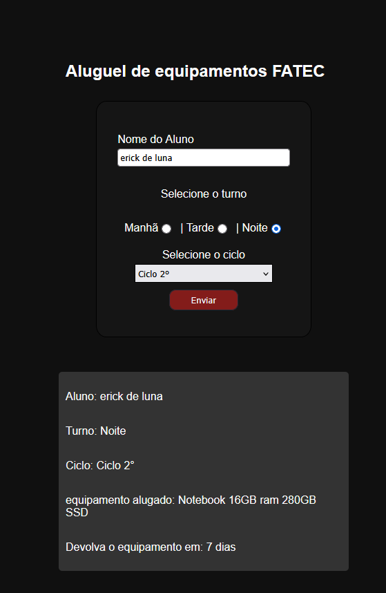

# Aluguel de Equipamentos FATEC

Formulário web para reserva de equipamentos escolares, desenvolvido como trabalho da disciplina de Desenvolvimento Web no curso de Análise e Desenvolvimento de Sistemas da Fatec.



## Sobre o projeto

O objetivo é simular o pedido de aluguel de um equipamento por um aluno. O usuário preenche os dados no formulário e o JavaScript processa as informações e mostra o resultado na própria página, sem back-end.

## Funcionalidades

- Campo de texto para o nome do aluno
- Seleção do turno (manhã, tarde ou noite)
- Seleção do ciclo (1º ao 6º) em uma lista suspensa
- Envio do formulário e exibição do resultado na tela

## Tecnologias

- **HTML5**: estrutura e formulário
- **CSS3**: estilização e layout
- **JavaScript**: tratamento dos dados do formulário e atualização da página

## Estrutura de arquivos

```
├── index.html   # estrutura da página e do formulário
├── style.css    # estilos
└── script.js    # lógica do formulário
```

## Como executar

1. Clone o repositório:

   ```bash
   git clone https://github.com/ErickLuna711/aluguelEquipamentoFATEC.git
   ```

2. Abra o arquivo `index.html` em qualquer navegador. Não é necessário instalar nada.

## Aprendizados

- Criação de formulários com campos de texto, `radio` e `select`
- Manipulação do DOM com JavaScript
- Organização do projeto em HTML, CSS e JS separados

## Próximos passos

- Validar os campos antes do envio (nome vazio, turno não selecionado)
- Tornar o layout responsivo para celular
- Salvar as reservas e integrar com um back-end

## Autor

**Erick de Luna**
[LinkedIn](https://www.linkedin.com/in/erick-deluna-1a175a30b) | [GitHub](https://github.com/ErickLuna711)
